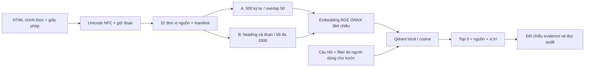

# Ghi chú để hiểu và trình bày bài

Hà Huy Thái — 2A202603682 — lớp 3A.

## Bài toán

Đọc tài liệu kỹ thuật về thư viện chuẩn Python, chuyển thành vector và lấy ba đoạn phù hợp cho câu hỏi. Mục tiêu là đo tác động của **chuẩn bị dữ liệu**. Bài này không tạo câu trả lời bằng chatbot; grounding đo độ đủ của các đoạn truy xuất.

## Luồng dữ liệu

C dùng đúng chunk và vector của B, chỉ thêm filter từ câu hỏi. Câu không có filter phải cho kết quả B/C giống nhau. Nếu B và C khác cả chunk thì không còn tách được ảnh hưởng của metadata.

## Những điểm cần giải thích được

1. **Một trang nội dung là gì?** Với HTML, mỗi trang tham chiếu module là một đơn vị nguồn độc lập có ý nghĩa. Cả 32 đơn vị đều ≥1.500 ký tự sau chuẩn hóa. Đây không phải số trang PDF và không phải số chunk.
2. **Vì sao lưu offset?** `char_start` và `char_end` trỏ đúng vào `data/pages.jsonl`, giúp kiểm tra chunk không bị bịa hoặc lấy nhầm nguồn; `page` là tên module, chẳng hạn `pathlib`.
3. **Vì sao NFC?** Hai cách biểu diễn Unicode có thể trông giống nhau nhưng khác chuỗi ký tự. NFC giúp đối chiếu evidence ổn định; pipeline không dùng NFKC vì có thể thay ký hiệu có ý nghĩa trong code.
4. **Embedding thật ở đâu?** `MyEmbedder` gọi FastEmbed chạy trọng số ONNX local. Model fingerprint, revision, kích thước và thư viện nằm trong `data/model_manifest.json` và `results/environment_dev.json`. Không dùng random hay TF-IDF làm embedding chính.
5. **Vector store ở đâu?** QdrantClient với `path=results/qdrant`, ba collection `python313_A/B/C`, cosine. Local mode thực hiện exact search; không phải phép cosine tự viết. Storage nội bộ của Qdrant do thư viện quản lý.
6. **Làm sao không trùng?** ID chunk lấy từ hash tài liệu, page, offset và text, rồi ánh xạ UUID5. Upsert cùng ID ghi đè; đồng bộ toàn corpus xóa ID cũ không còn. Mã kiểm thử có tình huống bỏ một chunk và đóng/mở lại store.
7. **Hit@3 khác đúng nguồn thế nào?** Truy về đúng trang nhưng thiếu điều kiện vẫn không được hit. Cần một chunk chứa đủ evidence, hoặc gold thay thế đã khai báo. Nhiều chunk chứa từng nửa không được cộng thành hit chính.
8. **Vì sao dev/test?** Dev dùng để chọn cấu hình. Test chỉ chạy sau khi lưu quyết định chọn. Tác giả biết nội dung gold khi xây câu hỏi, nên đây không phải đánh giá mù; năm câu test cũng quá ít để suy rộng.
9. **Filter có rò rỉ đáp án không?** `category` được cung cấp ngay trong câu hỏi như ngữ cảnh người dùng, lấy từ chapter chính thức và có nhiều module cùng category. Code không cho filter bằng `document_id`; không suy filter từ gold sau tìm kiếm.
10. **Vì sao metadata đầy đủ chưa chắc hữu ích?** Nó giúp truy nguồn, nhưng filter sai từ người dùng có thể loại mất đoạn đúng; filter quá rộng có thể không cải thiện thứ hạng.
11. **Vì sao không lấy Hit@3 làm coherence?** Một đoạn tìm trúng từ khóa vẫn có thể bắt đầu giữa câu. Coherence phải đọc chunk tại cùng vị trí nguồn theo thang 0–2; grounding đọc đủ top-3 và điều kiện trả lời.
12. **Chi phí 0 có nghĩa gì?** Chỉ chi phí API embedding bằng 0 USD. Máy, điện, mạng và thời gian người làm không được quy ra tiền.

## Trước khi nộp

Đọc báo cáo và `results/audit_review.md`, đối chiếu các nhãn AI hỗ trợ với nguồn. Không nhận các nhãn là do học viên chấm nếu chưa tự kiểm tra. Tự chạy lại lệnh trong `docs/RUNNING.md` nếu có thể; kiểm tra quyền truy cập repo, tạo commit và điền SHA trong STUDENT trước khi nộp link theo kênh lớp.
